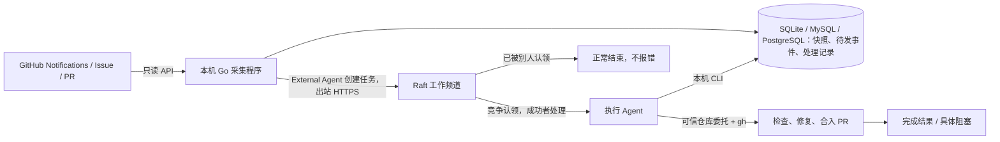

# GitHub Work Assistant for Raft

把你关注的 GitHub Issue、PR、评审和 CI 变化送到 Raft，由工作频道中的执行 Agent 竞争认领，按仓库委托检查、修复和合入 PR，汇报完成结果或需要决定的事项。默认关注公开仓库；私有仓库按配置启用。

每人部署一套。程序使用你已有的 `gh` 登录采集事实，以独立 **External Agent** 身份为每个 PR/Issue 建立固定任务和讨论区；首次认领的 Agent 持续负责，并在同一台机器读取本地证据。后续事件追加到原讨论区，只有人工交接才更换负责人。程序不调用模型，模型和工作执行由 Raft 管理。



## 快速开始

在运行 Raft 执行 Agent 的 Linux 电脑上，使用同一个操作系统账号准备 Go 1.27.3+ 和 GitHub CLI。默认使用本地 SQLite 文件；选择新建 MySQL 容器时才需要 Docker 和 Compose 插件。用 `gh auth login --hostname github.com` 登录自己的 GitHub 账号。在 Raft 创建一个独立的 External Agent，并取得它的登录 token；将采集身份和希望参与的执行 Agent 加入同一个工作频道。采集身份只负责发布任务。

```bash
gh repo clone spencercjh/github-work-assistant
cd github-work-assistant
make setup
```

安装向导先选择存储位置：本地 SQLite、新建 MySQL 容器，或已有 MySQL／seekdb／TiDB／PostgreSQL。随后填写工作频道、可选的通知收件人，并隐藏输入 External Agent token。向导核对身份、生成私有配置、初始化表结构并执行诊断。已有安装不会被覆盖。各后端的连接方式和验证范围见[存储配置](docs/STORAGE.md)。

把生成的 `state/assistant/EXECUTOR.md` 路径交给频道里的执行 Agent，并明确委托它处理这些通知。然后启动采集：

```bash
state/assistant/run serve
```

新安装无需注册 Raft App，也无需域名或公网入站端口。完整的凭据取得、后台启动、验证和故障恢复步骤见 **[快速部署](docs/QUICKSTART.md)**。

## 能做什么

- 只配置任务频道，由用户管理频道成员。每个 PR/Issue 首次创建一个共享任务，认领成功者持续负责；后续事件回复原讨论区，完成状态不清除负责人。落选者静默结束，不重试争抢、不另建任务。

- 从 GitHub Notifications 自动发现 Issue／PR，也支持配置固定关注对象。私有仓库可按组织、仓库或当前账号全部可读范围启用，见[私有仓库配置](docs/PRIVATE-REPOSITORIES.md)。评论、评审、时间线及当前 head 的检查会完整翻页读取；响应过大时显式报错。
- 通知标题包含事项名称和主要变化，正文列出评论、评审、检查或状态变化，再提供 GitHub 链接。公开评论可附简短摘录；私有通知的标题及摘要需通过 `private_notification_details` 明确启用，评论正文仍保留在本机。
- 快照和待发事件一起持久化。发送失败保留待发状态并退避重试；完整消息请求在首次发送前保存，重启后使用相同幂等键和内容重试。
- 执行 Agent 读取事件前后差异、最新快照和既有处理记录，避免把重复通知当作新工作。Raft 接受消息与 Agent 完成处理分别记账。
- 配置可信仓库指引和 `github_actions` 后，执行 Agent 可自主检查、修改、验证和合入 PR。持续授权范围内不逐次请求确认；合入前检查实时归属和 head/base，合入后核对结果。未配置的仓库默认只读，GitHub 写操作由执行者通过 `gh` 完成。见[仓库操作授权](docs/REPOSITORY-WORK.md)。
- 新委托可通过 `request-work` 应用于已有事项，无须等新的 GitHub 活动，也不重放归档通知。

## 运维与开发

| 需要做什么 | 入口 |
| --- | --- |
| 安装、配置、常驻运行、备份和恢复 | [快速部署](docs/QUICKSTART.md) |
| 选择数据库、配置云数据库连接、扩展持久化实现 | [存储配置与实现](docs/STORAGE.md) |
| 让执行 Agent 处理通知和保存结果 | [Agent 工作说明](docs/AGENT-WORKFLOW.md) |
| 仓库操作范围与本地工作命令 | [仓库工作指引](docs/REPOSITORY-WORK.md) |
| 已有 App 部署的 OAuth／HTTPS 接入 | [App 模式参考](docs/APP-MODE.md) |
| 本次验证的范围和限制 | [部署验证](docs/SETUP-VALIDATION.md) |

```bash
make check build test
# 默认测试使用临时 SQLite；服务器测试会清空指定测试库的 ghraft_* 表。
GHRAFT_TEST_DRIVER=postgres GHRAFT_TEST_DSN_FILE=/private/path/test-dsn make integration
# 本地 SQLite + 模拟 GitHub/Raft，验证首次安装，不需要 Docker。
python3 scripts/smoke-setup.py
# 单独验证新建 MySQL 容器，结束时删除本次测试卷。
python3 scripts/smoke-setup.py --database mysql
```

当前支持单用户、多执行 Agent、单机部署。默认每 120 秒查询 GitHub，尚未实现 Webhook、多租户服务或跨主机执行。轮询快照无法保证还原采集间隔内出现后又被删除的内容；幂等写也不能替代执行 Agent 的重复事件检查。

External Agent 接口按官方 SDK 0.30.0 的契约实现。协议模拟测试不等于真实账号完成登录、收信和处理；部署者应完成快速部署中的实际接收验证。

## 来源

- [Raft External Agents](https://docs.raft.build/developers/sdk/external-agents/)
- [Raft SDK API Client](https://docs.raft.build/developers/sdk/api-client/)
- [GitHub CLI](https://cli.github.com/)
- [Docker Compose 安装](https://docs.docker.com/compose/install/linux/)
