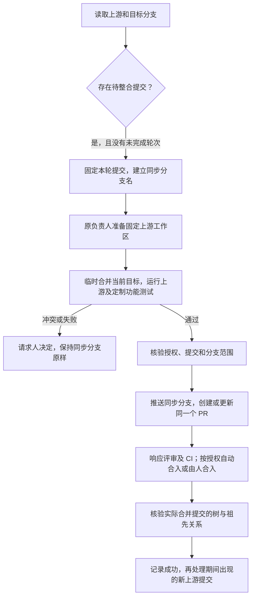

# 持续维护有定制改动的 fork

这项功能跟踪指定上游分支，把更新整合进保留定制能力的 fork。程序负责发现变化、保存轮次、关联同步 PR 和核对证据；默认同步 PR 只包含上游原始提交；需要修改定制代码时可显式启用分批适配；执行者负责理解改动、验证合并结果，并按可信仓库指引完成获准的 GitHub 操作。

每条规则沿用一项工作和同一负责人。同一时刻只有一轮同步，每轮固定上游提交；期间出现的新上游提交留到下一轮处理。合入并完成远端核验后，才推进成功位置。

## 配置维护规则

先按[快速部署](QUICKSTART.md)安装助手。使用同一个 GitHub 账号和操作系统账号；准备目标项目需要的编译、测试工具。同一 GitHub fork 网络内可直接使用远端比较；独立复制的仓库需配置下文的本地 Git 历史比较。两种方式均使用 merge commit；默认模式保留原始上游祖先关系，分批适配模式保留目标和适配分支的历史。目标仓库需要允许 merge commit；squash、rebase 和直接推送目标分支不属于本流程。默认禁止强制推送；旧同步分支需要替换时，必须由部署者配置下面的精确替换授权。

在实例的 `config.json` 中增加 `forks`，并为目标仓库增加明确的 `repositories` 指引。以下片段合并到已有配置，不能替代完整安装配置：

```json
{
  "forks": [
    {
      "id": "custom-engine",
      "upstream": { "repo": "upstream/engine", "branch": "main" },
      "target": { "repo": "your-org/engine", "branch": "main" }
    }
  ],
  "repositories": [
    {
      "repo": "your-org/engine",
      "goal": "持续吸收上游更新，保留并验证部署适配和自有行为。",
      "mode": "local-edit",
      "guide_file": "guides/engine.md",
      "task_target": "#github-work",
      "test_commands": [["make", "test"], ["make", "test-custom"]],
      "github_actions": ["push", "open-pr"]
    }
  ]
}
```

将 `examples/guides/fork.md` 复制到实例的 `guides/engine.md`，填写实际定制行为、验收条件和发布限制。`test_commands` 是参数数组，直接执行，不经过 shell 展开。修改配置后先运行 `"$INSTANCE/run" check-config`，通过后按部署方式重启采集服务。

| 配置 | 含义与限制 |
| --- | --- |
| `id` | 稳定的维护规则名称，小写字母、数字和连字符，最长 48 字符。持久化标识为 `fork:<id>`。已有规则的仓库或分支关系不能原地更换，需使用新名称。 |
| `upstream` | 只读来源。仓库名按 GitHub 大小写规则匹配，分支名保留大小写。 |
| `target` | fork 仓库及目标分支。一个目标分支只能有一条规则。 |
| `local_repository` | 可选的本地完整克隆绝对路径，用于独立仓库的历史比较。它属于规则标识的一部分；已有规则切换比较方式或迁移路径时使用新 `id`。 |
| `guide_file` | 由部署者维护，位于配置目录内；不能来自正在整合的 PR。说明定制能力的目的、测试方法和允许的操作。 |
| `test_commands` | 必填。覆盖上游行为和自有行为；只有编译成功不足以证明定制能力仍然成立。 |
| `github_actions` | 默认没有远端写权限。示例允许推送同步分支和创建 PR，由人合入。需要自动合入时，再明确加入 `merge` 并写清合入条件。 |

仓库指引仍按仓库生效，应写明授权只适用于哪些维护工作，不能把它理解为该仓库所有 PR 均获准操作。Project-HAMi 社区目标仍仅允许调查，因此不能配置为可修改的维护目标。

分支采集独立于 Notifications。可以只配置 `forks` 并关闭 `discover_notifications`、清空 `watches`。如果上游和目标已经没有待整合提交，首次采集只建立背景状态，不产生工作。

任一来源为私有仓库时，必须在 `private_repositories` 中允许访问。详细通知继续受 `private_notification_details` 控制。曾读取过的私有来源也受当前许可约束：移除许可后，不能通过后来变为公开的仓库读取旧私有上下文。

## 独立仓库与通知范围

不在同一 GitHub fork 网络中的仓库无法使用跨仓库比较接口。在采集服务所在机器上，通过 `gh repo clone your-org/engine /srv/github-cache/engine.git -- --bare` 创建完整克隆，并在对应 `forks` 条目中配置：

```json
"local_repository": "/srv/github-cache/engine.git"
```

`origin` 必须指向目标仓库，不能使用浅克隆或本地 grafts。程序先核实两端 GitHub 访问权限和分支 SHA，再用本地 Git 判断祖先关系；缺失的固定提交通过 `gh` 凭据从指定来源拉取，不移动本地分支、标签或工作区。比较忽略 replace refs；拉取、历史读取或锁失败会中止本轮采集，不会当成“尚未同步”。实际合入后的父提交和文件树仍需与 GitHub 及已通过的验证一致。克隆目录只能由可信部署者管理，不能由 PR 内容指定。

若只想维护某个 fork，同时继续接收其他仓库的 Notifications，可在顶层配置中排除该仓库的普通通知发现：

```json
"notification_exclude_repositories": ["your-org/engine"]
```

此列表按完整仓库名匹配，不区分大小写，不支持通配符。它仅过滤新的 Notifications 发现，不停止显式 `watches`、已有跟踪事项或 `forks`；同步 PR 仍由维护规则直接采集。排除的通知仍推进发现游标。私有目标还须单独列入 `private_repositories`，通知排除不授予或撤回仓库访问权限。

## 理解一次同步

以下准备、测试和合入步骤描述默认的原样同步。已启用 `adapted-batches` 时，源分支和批次选择按[分批适配](#分批适配有较多定制的仓库)执行，其余授权与验证要求仍适用。



程序根据本轮稳定分支名发现已经创建的 PR。因此创建请求超时后，先刷新上下文；若 PR 已存在，继续使用它，不重复创建。PR 的评论、评审和检查从普通采集器读取，但归回维护工作，不再形成独立工作。

`work-context` 中 `fork` 是可恢复的进度，`snapshot.objects.fork` 是本次采集到的远端事实：

| 字段 | 用途 |
| --- | --- |
| `round`、`upstream_sha`、`initial_target_sha` | 本轮身份、固定上游和初始目标提交。 |
| `observed_upstream_sha` | 最近看到的上游位置，可能比本轮更新；不会打断当前适配。 |
| `sync_branch`、`pr` | 本轮工作分支和关联 PR；尚未创建时 `pr` 为 0。 |
| `validated_head`、`validated_base`、`validated_tree`、`validated_guide` | 上游原始提交、测试时目标提交、已验证合并结果的文件树及指引版本。 |
| `last_success_upstream_sha` | 已核验并记录成功的上游位置；发现、通知、测试通过都不会推进它。 |
| `next_attempt`、`retries` | 恢复处理的时间和已触发次数，时间为 Unix 秒；0 表示当前不安排自动唤醒。 |
| `current_event_id` | 目前证据对应的事件。旧通知过期时，读取此事件并等待投递确认。 |

## 准备和测试

先遵循[执行流程](AGENT-WORKFLOW.md)取得当前归属。刷新证据，读取完整指引和已有结果。下面的变量分别来自当前上下文与实际工作记录，不可自行编造；刷新后若 `stale=true`，使用 `current_event_id` 对应的新事件，等它送达后重新核验并关联。

```bash
"$INSTANCE/run" refresh-work-context --event "$EVENT_ID"

# 更新 EVENT_ID、VERSION、GUIDE 后，建立本轮通用参数。
work=(--event "$EVENT_ID" --executor "$EXECUTOR"
      --version "$VERSION" --guide "$GUIDE" --task "$TASK_ID")
"$INSTANCE/run" link-task "${work[@]}"
```

使用 `gh repo clone` 准备目标仓库的本地克隆，确认 `origin` 指向目标仓库。获取本轮固定上游与当前目标的提交对象；检查实际 SHA，不能用正在移动的分支名替代本轮输入。程序的工作区命令只操作本地 Git，不负责下载代码。

```bash
"$INSTANCE/run" prepare-worktree "${work[@]}" --repo "$LOCAL_CLONE"
```

命令返回独立工作区路径，HEAD 直接指向本轮上游提交，处于 detached 状态。`branch` 是允许推送的远端分支名；不能在此工作区添加整合提交或修改上游代码。旧版整合工作区保留在原位置，不会被重置或删除。

执行者先核对上游差异对定制功能的影响，再运行验证。程序会另外创建临时工作区，把当前目标分支与本轮上游合并，运行配置中的全部测试；临时合并不生成 commit，也不推送到 PR。发生文本冲突或测试失败时，请求决策，不能改写同步源来消除失败。

```bash
"$INSTANCE/run" verify-worktree "${work[@]}"
"$INSTANCE/run" test-worktree "${work[@]}"
```

`test-worktree` 成功返回 `passed=true`，同时保存上游 SHA、目标 SHA、合并文件树、指引版本及测试日志摘要。测试前后必须保持原始源提交和测试文件树不变。任一测试失败都会使本次证明不可用；开始测试时先清除上一份证明。目标分支或指引改变后需要重新测试，源分支继续保持本轮上游 SHA。`verify-worktree` 只检查源工作区，不证明测试已执行。旧版只绑定整合提交的证明不能用于新流程。

测试命令在未提交的临时合并工作区中运行，必须读取当前文件，不能仅测试 `HEAD`。需要导出源码的入口应使用 `git write-tree` 得到的合并树，并保留两端提交的记录；不能要求预先提交合并结果。

测试总时限为 15 分钟，输出上限为 16 MiB。测试子进程使用临时 HOME 和有限环境变量，不继承 GitHub token 等环境凭据；它仍可访问同一系统账号可读的文件，不是操作系统沙箱。需要凭据或专门环境的测试，应由部署者先建立受控测试入口，不能把密钥写进参数或指引。

## 推送、评审和合入

任何远端写入前，先检查授权及当前事实。`HEAD_SHA` 是本轮上游原始提交，`TARGET_SHA` 来自最新目标分支，`SYNC_BRANCH` 来自本轮进度：

```bash
"$INSTANCE/run" check-github-action "${work[@]}" \
  --action push --head "$HEAD_SHA" --base "$TARGET_SHA" --ref "$SYNC_BRANCH"
```

只有 `permitted=true` 才通过检查。通常只能正常推送，源必须等于本轮上游 SHA。若远端包含额外提交，先停止并请求是否替换或重新开始，不能自行整合进源分支。推送后刷新并关联新证据，再以 `--action open-pr` 和相同分支检查创建 PR；返回的 `repository`、`number`、`branch`、`target_branch` 是操作范围。已有 PR 时继续使用它。

更新标题和正文需单独配置 `edit-pr`，按同样参数使用 `--action edit-pr` 检查；检查绑定本轮原 PR、同步分支与当前 head/base，仅允许更新 `title` 和 `body`。该操作不要求代码测试证明，也不生成证明；推送和合入仍须通过原有验证。详见[更新已有 PR](REPOSITORY-WORK.md#更新已有-pr-的标题和正文)。

程序不会代执行者写入 GitHub。执行者仍需遵守仓库约定，使用 `gh` 创建 PR、读取评审与 CI，解释定制能力的保留方式。目标分支或可信指引变化后，必须重新测试合并结果。需要修改上游代码时转为单独的人工决定，不混入原样同步 PR。保留失败测试的原因与必要的人类决策，不能为追求通过而移除定制功能。

自动合入还需配置 `merge` 权限，并满足指引中的审阅和 CI 条件：

```bash
"$INSTANCE/run" check-github-action "${work[@]}" \
  --action merge --head "$HEAD_SHA" --base "$TARGET_SHA" --ref "$TARGET_BRANCH"
```

该检查核对上游原始提交及其合并结果的测试证明、远端 PR head/base、目标分支和当前归属；它不判定审阅质量，也不锁定 GitHub 分支。执行者应使用 `gh pr merge --merge --match-head-commit "$HEAD_SHA"`，不绕过保护规则。检查和远端写入之间仍可能有并发更新，必须核验实际结果；合并队列中的等待状态不代表已合入。

合入后刷新上下文，使用新事件与版本重新 `link-task`，在原讨论中报告，再记录：

```bash
"$INSTANCE/run" record-work-result "${work[@]}" \
  --report "$REPORT_ID" --outcome merged --summary-file result.txt
```

成功需要实际 PR 已合入，PR head 等于本轮上游原始提交；merge commit 的两个父提交必须分别为已测试目标和上游 SHA，且其文件树等于 `validated_tree`。merge commit 必须仍是目标分支祖先。目标分支随后前进不妨碍记录这一轮成功；这不表示后来新增的提交也通过了原测试。实际合并树不同则不能记录成功，应交由人工判断并补充验证。

仅授权创建 PR 时，由人合入后也可记录经过核验的 `merged` 事实；这不会赋予执行者合入权限。

处理完全部事件后按[任务收尾流程](AGENT-WORKFLOW.md#自动完成共享任务)调用 `finish-work`。同步 PR 合并只完成当前轮次，持续维护任务保持 `in_review`；后续上游变化继续使用原任务。

若最新报告已处理较早的检查或评审变化，但旧事件仍在 `pending` 中，逐条阅读并用 [`superseded` 判断](AGENT-WORKFLOW.md#用最新报告关联已处理的旧事件)关联到最新报告，再收尾。不要对过期证据补写工作报告，也不要仅为清空队列将未核对事件记为 `quiet`。旧的 `waiting` 报告保留，不需要改写成最终结果。

## 分批适配有较多定制的仓库

存在历史压缩合入或需要修改商业定制代码时，可由部署者在目标仓库的 `repositories` 条目设置 `"fork_sync_mode": "adapted-batches"`，并为对应规则配置完整的 `local_repository`。未设置时继续原样同步。此选项不更换规则名称、讨论或负责人，也不增加 `github_actions` 权限。已有原样同步轮次尚未推送、未创建 PR 时，可以直接开始第一批；已发布的轮次须先完成，或关闭未合入 PR 并明确 `restart-sync` 后再切换。

执行者先清点历史吸收范围，给出起点 SHA 和证据。初始起点只是此次迁移的范围边界，不表示此前所有上游功能都已吸收；文件相似度、合入日期或提交数量不能单独证明这一点。把依据和本批计划写入本地 UTF-8 文件，再调用：

```bash
"$INSTANCE/run" start-sync-batch "${work[@]}" \
  --after "$BASELINE_SHA" --count 1 --reason-file batch-plan.txt
```

程序沿当前上游的第一父提交链选择起点之后最早的变更，按依赖顺序推进，不按提交时间排序。`--count` 默认为 1，上限为 50；一个上游 merge commit 算一项主线变更，需按其第一父提交核对整项合入差异。起点不在当前主线上时停止，不猜测替代起点。

开始批次会产生新证据，但沿用原工作和负责人。重新读取 `current_event_id`，等待投递后更新 `work` 参数并 `link-task`，再运行 `prepare-worktree`。工作区创建在本批初始目标提交上，使用返回的 `sync_branch` 本地分支；执行者可以按 `batch_commits` 清单移植、处理冲突并提交适配。逐项记录原始 SHA、实际移植或已存在的依据、商业行为的保留方式和测试范围。程序不自动解决冲突，也不能仅凭 Git 历史证明适配语义正确。

`test-worktree` 验证实际适配 HEAD 与当前目标的临时合并结果。验证前要求已提交、工作区干净并保留初始目标的历史；初始目标本身不能当作完成的批次。失败后不得推送。没有实际代码差异时，可以在尚未发布前扩大本批范围，保留相同起点；当前没有直接跳过空批次并推进成功位置的入口。

推送和 PR 创建仍使用前文的 `check-github-action` 流程，`HEAD_SHA` 改为实际适配提交。源提交、目标或可信指引改变后重新测试。适配 PR 应明确列出来源范围与偏离上游的原因，供审阅者判断；仅有测试通过不代表每项上游功能都已正确移植。是否可自动合入仍由单独的 `merge` 授权及指引决定。

合入后核验实际 merge commit 的两个父提交分别等于已测试目标与适配 HEAD，文件树等于测试结果，且实际 merge commit 仍在目标历史中。此模式不要求移植后的提交包含原始上游 SHA，也不会把移植冒称为保留上游祖先关系。只有核验通过并记录 `merged`，才把成功位置推进至本批最后一项来源提交。

下一批仍使用同一项工作。刷新并关联新证据后调用 `start-sync-batch --count 1 --reason-file next-batch.txt`，省略 `--after`，程序从已核验位置继续；传入其他起点会被拒绝。未完成且尚未发布的批次可重新选择数量，但必须沿用原起点，旧工作区原样保留。已发布且未完成的 PR 不能被新批次静默替换；关闭后先明确 `restart-sync`，再从相同位置重试。

进度中的 `adaptation_baseline` 保留首次选择的范围起点，`batch_after`、`batch_commits` 和 `batch_reason` 记录当前批次。`last_success_upstream_sha` 只记录已核验完成的位置；`next_batch_ready` 表示完成后还有上游变更可选。服务重启保留这些记录。撤回模式或仓库权限后，旧批次不能继续写入；恢复时必须重新核对当前规则。

## 替换旧同步分支

默认 `push` 权限不允许改写分支历史。确需将旧版整合分支改为原始上游时，部署者可在该仓库指引配置中加入精确授权：

```json
"sync_branch_replacement": {
  "branch": "ghraft/sync/custom-engine/当前轮次",
  "from": "旧远端提交的完整40位SHA",
  "to": "本轮上游提交的完整40位SHA"
}
```

三个值都必须与当前轮次匹配，且仍需 `push` 权限和新测试证明。`check-github-action --action push` 成功时返回 `expected_remote_head`，执行者必须用 `--force-with-lease=refs/heads/<branch>:<expected_remote_head>` 推送原始上游 SHA。远端变化时停止；不能用无条件 `--force` 或扩大到其他分支。替换完成并结束本轮后移除该授权；修改指引会使旧测试证明失效。

## 等待与恢复

| 情况 | 行为 |
| --- | --- |
| 等待 CI 或评审 | 保存 `waiting` 和具体继续条件；15 分钟后可唤醒原负责人，也会响应新远端事件。 |
| 代码已验证、等待后续操作 | 保存 `changes-ready`，1 小时后可继续检查。 |
| 执行中断、没有结果 | 新轮次首次 4 小时后恢复，后续按重试次数退避；一轮累计触发 5 次后进入 `needs-decision`，停止定时唤醒。 |
| 需要业务取舍或测试环境不足 | 保存 `needs-decision` 和具体问题，等待人明确下一步；新远端变化仍可被记录。 |
| PR 关闭而未合入 | 进入 `needs-decision`。决定重新尝试后运行 `restart-sync`，下一次采集建立新轮次，不继承旧验证或成功位置。 |
| 目标分支前进 | 旧测试证据不能用于写入；刷新、准备工作区、提交、重新测试。 |
| 服务退出后重启 | 保留数据库与工作区。恢复原轮次、原负责人和已创建 PR，不另建工作。 |
| 用户停止维护 | 关闭原工作会停止执行；从配置移除规则并重启会停止该规则采集。恢复需按原记录和许可核对，不删除旧进度来绕过限制。 |

`restart-sync` 需要当前事件、归属和版本参数，只适用于已关闭且未合入的 PR。它不会关闭 PR、删除工作区、强制推送或把放弃的轮次算作成功。

`"$INSTANCE/run" status` 的 `forks` 包含保留的进度，`fork_errors` 包含最近采集错误；删除配置不会删除历史进度，因此这些字段也可能包含已停用规则。查询失败时不推进成功位置。工作区和测试日志保留在 `workspace_root`，需在不再需要恢复后由部署者清理；现有事件正文保留策略不删除源码工作区。

## 实现与验证边界

`WorkDefinition` 统一解析普通事项和维护规则；`ForkSource` 增加分支事实采集，纯函数规划下一轮，工作区及结果核验各有对应实现。两类工作复用事务事件、可靠投递、固定负责人、可信指引和报告关联。轮次进度和 PR 关联保存在现有关系存储中，与快照和待发事件一起提交，避免进度与通知错位。

自动化测试使用真实本地 Git 历史与模拟远端：覆盖定制功能回归失败、目标移动后重测、人工合入、合入后分支前进、错误合并树、创建 PR 响应丢失、关闭后重试、重启、并发采集、负责人交接和私有访问撤回。运行 `go test -race ./...`。这不等同于真实 fork 的部署验收；实际接入时仍需选择项目、配置定制行为与测试，并核对一轮真实 PR 的结果。

若旧版同步 PR 已由人合入，但升级前未保存结果，其 PR head 仍是旧整合提交，不能套用新证明。核实实际历史并决定结束旧轮次后，可显式调用 `restart-sync`：只有 PR 已关闭、head 不同于本轮上游，且当前目标已包含本轮上游时才允许。它只解除旧轮次对后续更新的阻塞，不写入 `last_success_upstream_sha`，不宣称旧测试已通过新规则，也不改写已合入的历史。后续新上游建立新轮次并重新测试。原样同步 PR 的正常合入仍须按上述流程核验，不能通过此入口跳过。
